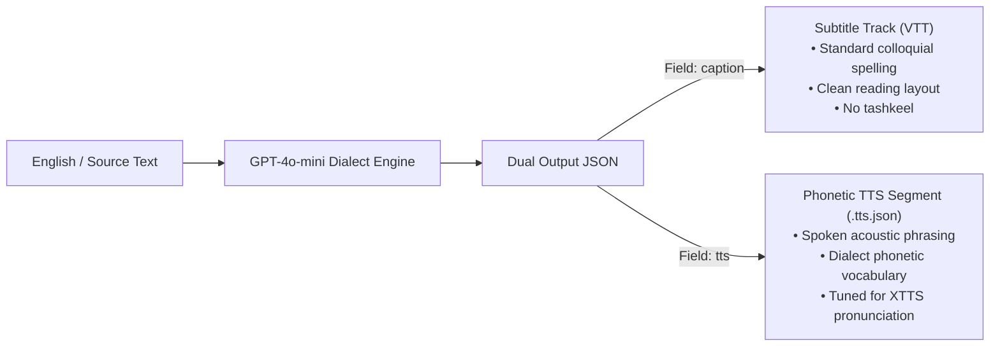
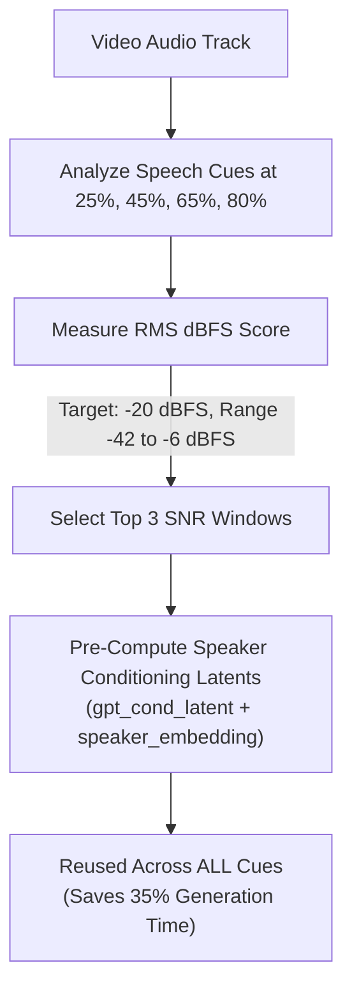
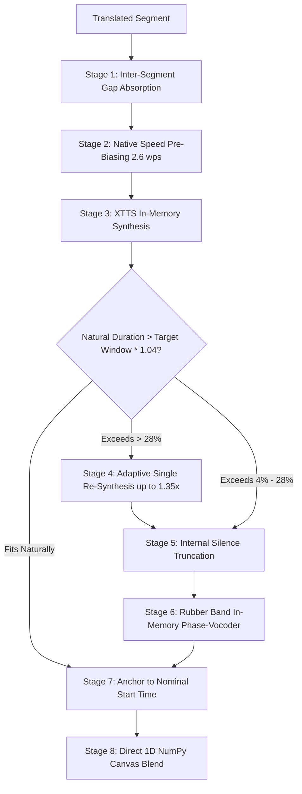
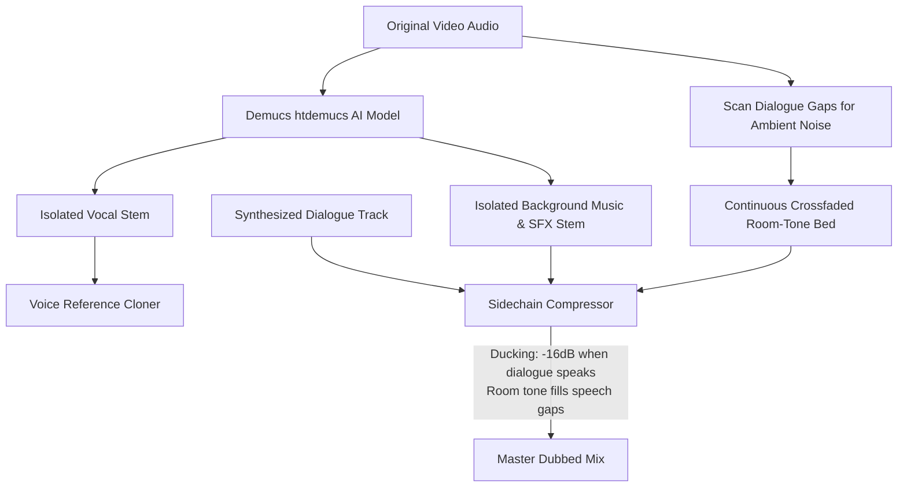
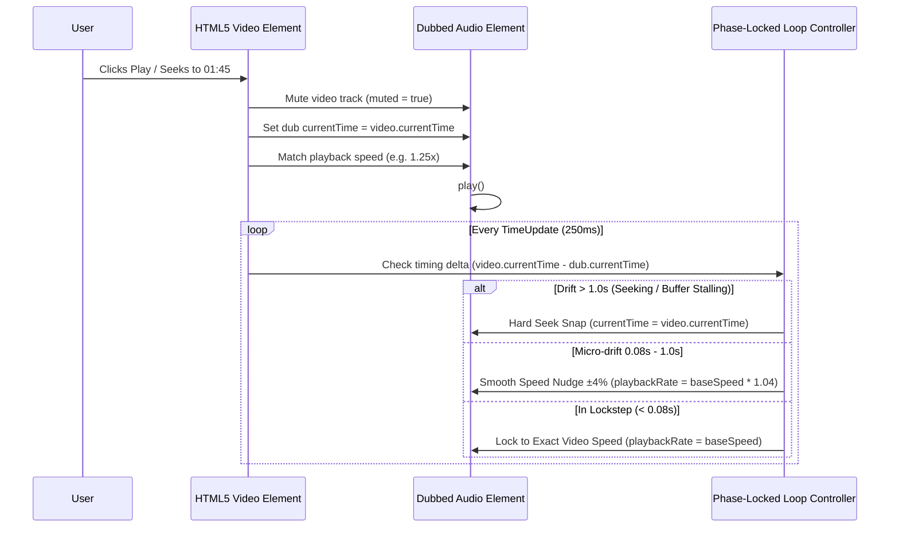

# 🎙️ TutIn AI Dubbing & Speech Pipeline: End-to-End Technical Specification

This document details the architecture, acoustic processing, algorithms, dialect engineering, and synchronization mechanisms behind TutIn's AI Dubbing Engine — from speech-to-text transcription to lockstep playback in the custom video player.

---

## 📑 Table of Contents
1. [Pipeline Architecture Flow](#1-pipeline-architecture-flow)
2. [Phase 1: Audio Extraction & Transcription](#2-phase-1-audio-extraction--transcription)
3. [Phase 2: Sentence Stitching & Punctuation Restoration](#3-phase-2-sentence-stitching--punctuation-restoration)
4. [Phase 3: Dialect Translation & The Dual-Transcript Architecture](#4-phase-3-dialect-translation--the-dual-transcript-architecture)
5. [Phase 4: Voice Extraction, Cloning & Model Optimization](#5-phase-4-voice-extraction-cloning--model-optimization)
6. [Phase 5: Lip-Sync & Gap-Fitting Timing Engine](#6-phase-5-lip-sync--gap-fitting-timing-engine)
7. [Phase 6: Audio Separation, Room-Tone & Sidechain Ducking](#7-phase-6-audio-separation-room-tone--sidechain-ducking)
8. [Phase 7: Video Player Integration & Playback Synchronization](#8-phase-7-video-player-integration--playback-synchronization)
9. [Performance & Resource Optimization Matrix](#9-performance--resource-optimization-matrix)

---

## 1. Pipeline Architecture Flow

```mermaid
flowchart TD
    subgraph S1["1. Audio Extraction & Transcription"]
        V[Source Video MP4/TS] -->|FFmpeg 16kHz Mono Stream| EXT[Video Route /audio-16k]
        EXT -->|ArrayBuffer / Float32| WW[Whisper Web Worker]
        WW -->|WASM / WebGPU| STT[Whisper ASR Engine]
        STT --> SIL[Silence Calibrator & Hallucination Sanitizer]
        SIL --> CUES[Timestamped Source Cues]
    end

    subgraph S2["2. Stitching & Punctuation Restoration"]
        CUES --> STITCH[Acoustic Sentence Stitcher]
        STITCH --> PUNCT_CHECK{Punctuation Density < 0.04?}
        PUNCT_CHECK -- Yes --> PUNCT_ENG[Punctuation Engine: OpenRouter / Python / Heuristic]
        PUNCT_CHECK -- No --> STITCHED[Stitched Grammatical Sentences]
        PUNCT_ENG --> REMAP[Lookahead Token Re-aligner]
        REMAP --> STITCHED
    end

    subgraph S3["3. Dialect Translation & Phonetic Dual-Transcript"]
        STITCHED --> ROUTE{Target Dialect?}
        ROUTE -- "ar-eg / ar-sa" --> OR[OpenRouter GPT-4o-mini Dual JSON]
        ROUTE -- "Other Languages" --> NLLB[NLLB-200 Worker Thread]
        OR --> PHON[Phonetic Nudge & Glossaries]
        PHON --> DUAL["Dual-Track Artifacts:<br/>1. Readable VTT Captions<br/>2. Phonetic TTS Segments"]
        NLLB --> DUAL
    end

    subgraph S4["4. Voice Extraction & Latent Conditioning"]
        V --> REF_EXT[SNR Multi-Window Reference Voice Extractor]
        REF_EXT --> DEMUCS{Preserve Background?}
        DEMUCS -- Yes --> HT[Demucs htdemucs Vocal Stem Separation]
        DEMUCS -- No --> RAW_VOICE[High-SNR Voice Reference 24kHz]
        HT --> RAW_VOICE
        RAW_VOICE --> LATENT[XTTS Latent Conditioning Pre-computer]
    end

    subgraph S5["5. Intelligent Gap Fitting & Neural Synthesis"]
        DUAL --> GAP_CALC[Target Gap & Inter-Segment Absorption]
        GAP_CALC --> PRE_BIAS[Native Speed Pre-Biasing 2.6 wps]
        PRE_BIAS --> XTTS[Coqui XTTS v2 Inference Engine]
        LATENT --> XTTS
        XTTS --> DUR_CHECK{Exceeds Gap + 4%?}
        DUR_CHECK -- "Exceeds > 28%" --> RETRY[Adaptive Re-Synthesis at Higher Speed]
        RETRY --> SIL_TRIM[Internal Pause Truncation]
        DUR_CHECK -- "Slight Exceed" --> SIL_TRIM
        SIL_TRIM --> RUBBER[In-Memory FFmpeg RubberBand Transient Stretch]
        RUBBER --> CANVAS[1D NumPy Float32 Master Timeline Canvas]
        DUR_CHECK -- "Fits" --> CANVAS
    end

    subgraph S6["6. Audio Mastering & Sidechain Ducking"]
        CANVAS --> NORM[Peak Normalization & Limiter]
        NORM --> DUCK{Background Track Present?}
        DUCK -- Yes --> SIDECHAIN[FFmpeg Sidechain Compressor -16dB Ducking]
        DUCK -- No --> MP3_EXP[LAME 128kbps Mono MP3 Export]
        SIDECHAIN --> MP3_EXP
    end

    subgraph S7["7. Video Player Lockstep Synchronization"]
        MP3_EXP --> DUB_SERVER[FastAPI / Node Companion Stream]
        DUB_SERVER --> AUDIO_TAG["&lt;audio ref=dubAudioRef&gt;"]
        V --> VIDEO_TAG["&lt;video ref=videoRef (muted)&gt;"]
        VIDEO_TAG <-->|Phase-Locked Loop ±4% Nudge| AUDIO_TAG
    end
```



---

## 2. Phase 1: Audio Extraction & Transcription

### 1. Zero-Download 16kHz WAV Stream
Standard web speech-to-text often buffers gigabytes of MP4 video into the browser's memory heap, causing crashes and high latency.
- TutIn routes extraction through `GET /api/videos/:id/audio-16k`.
- Node.js spawns FFmpeg on the host system to extract, resample, and convert to mono WAV on the fly:
  ```bash
  ffmpeg -loglevel error -i "<videoPath>" -vn -acodec pcm_s16le -ar 16000 -ac 1 -f wav pipe:1
  ```
- The stream is transferred over HTTP. The browser parses raw PCM bytes directly into a `Float32Array` via `parseWavToFloat32`, avoiding Web Audio `AudioContext` overhead.

### 2. Isolated Web Worker Execution
- Speech recognition runs inside a dedicated browser Web Worker (`src/utils/whisperWorker.js`).
- Automatically switches models:
  - `Xenova/whisper-tiny.en` for English lectures (~39MB, optimized vocabulary).
  - `Xenova/whisper-tiny` multilingual for non-English sources.
- Uses **WebGPU** hardware acceleration when available in the browser (`'gpu' in navigator`), falling back to multi-threaded **WASM**.

### 3. Speech Onset Detection & Silence Offset Calibration
Whisper frequently snaps the start of the first cue to `0.00s` even if the video begins with several seconds of introductory silence.
- `detectSpeechOnset` runs an energy detector across 50ms windows (20ms hops) of the initial 30 seconds:
  $$\text{Energy} = \sqrt{\frac{1}{N} \sum_{i=0}^{N-1} s[i]^2}$$
- An adaptive threshold is calculated from the quietest 20% of frames:
  $$\text{Threshold} = \min(0.04, \max(0.012, \text{NoiseFloor} \times 3.5))$$
- When 3 consecutive frames (60ms) exceed the threshold, true speech onset is established.
- A 150ms pre-roll safety margin is added to preserve soft initial consonants (`p`, `t`, `s`, `k`, `th`).
- `calibrateInitialSilenceOffset` adjusts the first chunk's start timestamp.

### 4. Hallucination Filtering
Cues matching known Whisper silence loops or sound tags are removed before translation:
```javascript
const WHISPER_HALLUCINATION_REGEX = /^\s*(?:thank\s+you\s+for\s+watching|thanks\s+for\s+watching|please\s+like\s+and\s+subscribe|please\s+subscribe|like\s+and\s+subscribe|don'?t\s+forget\s+to\s+subscribe|subscribe\s+to\s+my\s+channel|see\s+you\s+in\s+the\s+next\s+video|subtitles?\s+by\b|transcribed\s+by\b)[.!]?\s*$/i;
```

---

## 3. Phase 2: Sentence Stitching & Punctuation Restoration

Raw automatic speech recognition outputs broken 3–7 word chunks. Synthesizing voice on unstitched cues results in robotic, halting cadence.

### 1. Acoustic & Syntactic Stitching (`stitchCuesIntoSentences`)
Subtitle cues are merged into natural grammatical sentences based on 4 criteria:
1. **Acoustic Pause Gap**: If the gap between the current cue end and next cue start is $\ge 350\text{ ms}$, an audible breath/pause boundary is registered.
2. **Terminal Punctuation**: Ends with `.`, `?`, `!`, `؟`, `。`, or `…` (excluding abbreviations like `Mr.`, `Dr.`, `e.g.`, `vs.`).
3. **Discourse Transition Markers**: Next cue begins with transitional markers (`Next`, `However`, `Furthermore`, `Moreover`, `Therefore`, `Now`, `So`).
4. **Boundary Limits**: Sentences are capped at $\le 4.5\text{ seconds}$ or $\le 90\text{ characters}$ to prevent temporal smearing across timestamps.

### 2. Punctuation Density Check
If subtitles are imported without punctuation:
$$\text{Density} = \frac{\text{Count}(\text{Terminal Marks})}{\text{Total Word Count}}$$
If $\text{Density} < 0.04$ (fewer than 1 mark per 25 words), punctuation restoration is triggered.

### 3. Three-Tier Punctuation Architecture
- **Tier 1 (Cloud Pass)**: Fast zero-download GPT-4o-mini pass with strict instructions preserving word order and counts.
- **Tier 2 (Local Neural Model)**: Connects to the Python server `/punctuate` endpoint running a dedicated sequence tagger.
- **Tier 3 (Heuristic Engine)**: Instant fallback evaluating acoustic pauses ($\ge 550\text{ ms}$), question markers (`What`, `Why`, `How`, `هل`, `لماذا`), and conjunctions.

### 4. Lookahead Alignment (`remapPunctuatedTextToCues`)
To assign the punctuated words back to the exact millisecond `[start, end]` cue timestamps, a 4-token lookahead matcher synchronizes words to cue boundaries. Excess generated tokens are discarded to prevent outro speech hallucinations.

---

## 4. Phase 3: Dialect Translation & The Dual-Transcript Architecture

Standard Modern Standard Arabic (MSA) sounds unnatural for technical instruction. TutIn features dedicated support for **Egyptian Spoken Arabic (`ar-eg`)** and **Gulf/Saudi Spoken Arabic (`ar-sa`)** via a dual-transcript system:



### 1. Custom Prompts for Spoken Dialects

#### Egyptian Spoken Arabic (`ar-eg`) Prompt
```text
You are an expert translator specializing in spoken Egyptian Arabic (العامية المصرية).
Translate the input into authentic spoken Egyptian Arabic dialect — NOT formal Modern Standard Arabic (MSA). Use colloquial vocabulary, contractions, and everyday phrasing that a native Egyptian speaker would use in casual conversation.

CRITICAL ORTHOGRAPHY & TTS RULES:
1. Use natural, authentic colloquial Egyptian words (e.g. use 'دلوقتي', 'علشان' or 'عشان', 'كده', 'قلتله', 'إيه', 'إزاي', 'فين', 'ليه', 'مين', 'برضه', 'كتير', 'شوية', 'قاعد', 'طريق', 'فوق', 'وقع').
2. DO NOT include diacritics/tashkeel (no fatḥah, ḍammah, kasrah, sukūn, shaddah). Clean unvowelized text is required for text-to-speech models.
3. DO NOT invent non-standard pseudo-phonetic spellings with trailing or isolated hamzas (e.g. NEVER write 'طَرِيء' or 'فُوء' or 'وِئِع' or 'أَاعِد'). Write words using standard colloquial Arabic spelling.

CRITICAL ANTI-HALLUCINATION RULES:
1. Translate ONLY what is explicitly present in the input text. NEVER add extra facts, explanations, or conclusions not found in the input.
2. DO NOT complete unfinished thoughts or trail-off sentences. If the input is incomplete, translate only the incomplete fragment.
3. DO NOT add conversational filler, transitions, or greetings (e.g. do NOT insert "يا جماعة", "زي ما انتو شايفين", "خلونا نشوف", "أهلاً بيكم") unless equivalent words are in the input.
4. If the input consists solely of non-speech markers (e.g. music notes, laughter, applause, silence, or noise), return empty strings: {"caption": "", "tts": ""}.

You MUST output a strict JSON object with EXACTLY two fields:
{
  "caption": "Natural, conversational Egyptian Arabic text in standard readable spelling without diacritics.",
  "tts": "Natural, conversational Egyptian Arabic in standard spelling without diacritics, optimized for speech synthesis flow."
}

Do NOT wrap in markdown code blocks. Output ONLY the raw JSON object.
```

#### Gulf/Saudi Spoken Arabic (`ar-sa`) Prompt
```text
You are an expert translator specializing in spoken Gulf/Saudi Arabic (اللهجة الخليجية).
Translate the input into natural, conversational Gulf/Saudi Arabic dialect — NOT formal Modern Standard Arabic (MSA). Use colloquial Gulf vocabulary and everyday phrasing that a native Saudi or Gulf speaker would use in casual conversation.

CRITICAL ORTHOGRAPHY & TTS RULES:
1. Use natural, authentic colloquial Gulf words (e.g. use 'الحين', 'عشان', 'شلونك', 'شنو', 'إيش', 'كذا', 'وايد', 'زين', 'بعدين', 'تبي', 'أبي').
2. DO NOT include diacritics/tashkeel (no fatḥah, ḍammah, kasrah, sukūn, shaddah). Clean unvowelized text is required for text-to-speech models.
3. DO NOT invent non-standard pseudo-phonetic spellings with trailing or isolated hamzas. Write words using standard colloquial Arabic spelling.

CRITICAL ANTI-HALLUCINATION RULES:
1. Translate ONLY what is explicitly present in the input text. NEVER add extra facts, explanations, or conclusions not found in the input.
2. DO NOT complete unfinished thoughts or trail-off sentences. If the input is incomplete, translate only the incomplete fragment.
3. DO NOT add conversational filler, transitions, or greetings (e.g. do NOT insert "يا شباب", "طال عمرك", "زي ما تشوفون", "هلا والله") unless equivalent words are in the input.
4. If the input consists solely of non-speech markers (e.g. music notes, laughter, applause, silence, or noise), return empty strings: {"caption": "", "tts": ""}.

You MUST output a strict JSON object with EXACTLY two fields:
{
  "caption": "Natural, conversational Gulf Arabic text in standard readable spelling without diacritics.",
  "tts": "Natural, conversational Gulf Arabic in standard spelling without diacritics, optimized for speech synthesis flow."
}

Do NOT wrap in markdown code blocks. Output ONLY the raw JSON object.
```

### 2. Phonetic Glossaries
When offline NLLB-200 is used or during dialect normalization:

| Formal Modern Standard Arabic | Egyptian Spoken Replacement (`ar-eg`) | Gulf Spoken Replacement (`ar-sa`) |
| :--- | :--- | :--- |
| `الآن` (Now) | `دلوقتي` | `الحين` |
| `هكذا` (Like this) | `كده` | `كذا` |
| `لكي` (In order to) | `علشان` | `عشان` |
| `ماذا` (What) | `إيه` | `إيش` |
| `كيف حالك` (How are you) | `إزاي الحال` | `شلونك` |
| `كثيرا` (A lot / much) | `كتير` | `وايد` |
| `أريد` (I want) | `عايز` | `أبي` |

### 3. Tokenizer Anti-Corruption Filter
XTTS uses a BPE tokenizer that chokes when encountering invented pseudo-hamza spellings (`طريء` for `طريق` or `فوء` for `فوق`). `sanitize_dub_text` normalizes these tokens before synthesis:
```python
corrupted_words = {
    'طريء': 'طريق', 'فوء': 'فوق', 'وإع': 'وقع', 'وئع': 'وقع',
    'أاعد': 'قاعد', 'دلأتي': 'دلوقتي', 'ألتله': 'قلتله', 'أريب': 'قريب',
    'أدام': 'قدام', 'أفل': 'قفل', 'أدر': 'قدر', 'يبأى': 'يبقى', 'كِدا': 'كده'
}
```

---

## 5. Phase 4: Voice Extraction, Cloning & Model Optimization



### 1. Multi-Window SNR Voice Extraction
Instead of blindly sampling the first few seconds of a video (which often has music or silence), `extract_reference_audio`:
- Evaluates dialogue cues around the 25%, 45%, 65%, and 80% timeline marks.
- Filters for cues with $\ge 3\text{ words}$ and duration $\ge 2.5\text{s}$.
- Measures signal energy:
  $$\text{Score} = -|\text{dBFS} - (-20.0)| + (5.0 \text{ if } \text{dBFS} > -35.0)$$
- Selects the top 3 highest-SNR 9-second samples.

### 2. Conditioning Latent Pre-Computation
Generating speaker conditioning vectors on every chunk adds 1–2 seconds per cue.
TutIn computes latents once per job:
```python
gpt_cond_latent, speaker_embedding = xtts_model.get_conditioning_latents(
    audio_path=latents_ref_paths,
    sound_norm_refs=True
)
```
- By passing multiple reference paths, XTTS computes a blended acoustic mean of the speaker's voice across various phonemes.
- Reusing these latents across all cues cuts **30%–40% off total synthesis time** and maintains vocal consistency throughout the lesson.

### 3. Deterministic Voice Timbre
```python
torch.manual_seed(42)
if torch.cuda.is_available():
    torch.cuda.manual_seed_all(42)
```
Ensures consistent vocal identity across separate cues.

### 4. VRAM Idle Reaper
`schedule_idle_model_unload` runs a 10-minute timer. If no new dubbing jobs arrive within 10 minutes, the XTTS model is evicted from GPU VRAM:
```python
del TTS_MODEL
TTS_MODEL = None
gc.collect()
torch.cuda.empty_cache()
```

---

## 6. Phase 5: Lip-Sync & Gap-Fitting Timing Engine

Arabic translations are frequently 20%–35% longer in syllable count than original English lines. To maintain natural speaker pacing without running over dialogue gaps, TutIn executes an **8-stage progressive timing pipeline**:



### Stage 1: Inter-Segment Gap Absorption
Absorbs following silence pauses before applying any audio speed-up:
```python
nominal_window = max(0.2, end_sec - start_sec)
if i < len(segments) - 1:
    gap = max(0.0, segments[i + 1].get_start() - end_sec)
    absorbed_gap = min(gap, 0.45) # Absorb up to 450ms of trailing pause
    target_window_sec = nominal_window + absorbed_gap
else:
    target_window_sec = nominal_window + 0.60
```

### Stage 2: Native Speed Pre-Biasing
XTTS generates more natural voice rhythm when told to speak slightly faster during autoregressive decoding rather than post-process pitch stretching:
- Conversational rate estimation:
  $$\text{EstimatedSec} = \frac{\text{WordCount}}{2.6}$$
- If $\text{EstimatedSec} > \text{TargetWindow} \times 1.10$:
  $$\text{InitialSpeed} = \min\left(1.25, \frac{\text{EstimatedSec}}{\text{TargetWindow}}\right)$$
- If the phrase is brief:
  $$\text{InitialSpeed} = \max\left(0.88, \frac{\text{EstimatedSec}}{\text{TargetWindow}}\right)$$

### Stages 3 & 4: In-Memory Synthesis & Adaptive Retry
The audio is generated directly to memory as 16-bit PCM (no disk I/O). If the duration still exceeds the window by more than 28% ($> 1.28\times$), a single retry is executed at a higher speed (capped at $1.35\times$).

### Stage 5: Internal Silence Truncation (`trim_internal_silence`)
Instead of rushing voiced words, TutIn identifies internal silent pauses ($\ge 120\text{ ms}$ at $\le -36\text{ dBFS}$) and trims excess pause time (up to 350ms total per segment) while preserving at least 60ms of silence so the speaker can take a breath.

### Stage 6: FFmpeg RubberBand Phase-Vocoder Stretching
If residual overflow remains:
- Uses the `rubberband` phase-vocoder filter via an in-memory stdin/stdout pipe:
  ```bash
  ffmpeg -y -f wav -i pipe:0 -filter:a "rubberband=tempo=1.1200:transients=crisp:detector=compound" -f wav pipe:1
  ```
- **Why RubberBand?** Standard `atempo` causes consonant smearing. `rubberband` preserves crisp transient attacks on plosives (`b`, `p`, `t`, `d`, `k`, `q`) while compressing sustained vowels.

### Stage 7: Nominal Start Time Anchoring
Prevents cumulative drift from compounding over a 45-minute lesson:
```python
nominal_start_sample = int(start_sec * SAMPLE_RATE)
if nominal_start_sample < last_end_sample:
    overlap_samples = last_end_sample - nominal_start_sample
    max_allowed_shift = int(0.08 * SAMPLE_RATE) # Max 80ms shift permitted
    start_sample = nominal_start_sample + min(overlap_samples, max_allowed_shift)
else:
    start_sample = nominal_start_sample
```

### Stage 8: Direct 1D NumPy Timeline Canvas
Replaces Pydub's immutable buffer reallocation (`AudioSegment.overlay()`) with direct pointer assignment into a pre-allocated 1D NumPy `float32` array:
```python
master_canvas = np.zeros(total_canvas_samples, dtype=np.float32)
final_segment_audio = final_segment_audio.fade_in(20).fade_out(20)
seg_samples = np.array(final_segment_audio.get_array_of_samples(), dtype=np.float32) / 32768.0
master_canvas[start_sample:end_sample] += seg_samples
```

---

## 7. Phase 6: Audio Separation, Room-Tone & Sidechain Ducking

When **"Preserve Background Audio"** is enabled:



1. **Demucs Stem Separation**: `htdemucs` separates speech from background music, typing sounds, and sound effects.
2. **Room-Tone Bed Extraction**: In educational screen shares, total digital silence between words causes "dead room syndrome." TutIn extracts ambient noise from quiet intervals ($-52\text{ dBFS}$ to $-30\text{ dBFS}$), loops it with an 80ms crossfade, and layers it under the speech.
3. **Sidechain Compressor Ducking**: Using FFmpeg's `sidechaincompress`, the original music and ambient tracks are ducked by ~16dB while dialogue is present and smoothly rise back during pauses:
   ```text
   [bg_full][dialogue]sidechaincompress=threshold=0.035:ratio=6:attack=80:release=350[bg_ducked]
   ```

---

## 8. Phase 7: Video Player Integration & Playback Synchronization

In the browser frontend (`src/components/player/VideoPlayer.jsx`):



### 1. Dual-Element Decoupling
- The native audio of `<video ref={videoRef}>` is muted (`muted = true`).
- A dedicated `<audio ref={dubAudioRef} preload="auto">` tag streams the dubbed track.
- Decoupling enables clean synchronization across standard MP4, WebM, and `.ts` streams (via `mpegts.js`).

### 2. Phase-Locked Loop (PLL) Micro-Nudge Drift Correction
Hard seeks introduce audible clicks. TutIn uses a software PLL inside `handleTimeUpdate`:
- **Large Drift ($> 1.0\text{s}$)**: Triggered during seeking/scrubbing. Hard-snaps `dubAudio.currentTime = video.currentTime`.
- **Micro-Drift ($0.08\text{s} - 1.0\text{s}$)**: Caused by clock drift between video frame presentation and the audio DAC. Nudges the audio playback rate by **$\pm 4\%$**:
  $$\text{playbackRate} = \text{baseSpeed} \times 1.04 \quad (\text{or } 0.96)$$
  Realigns audio within 1–2 seconds with zero pitch change or audio artifacts.
- **In Lockstep ($< 0.08\text{s}$)**: Reverts to `baseSpeed`.

---

## 9. Performance & Resource Optimization Matrix

| Subsystem | Optimization Technique | Benefit |
| :--- | :--- | :--- |
| **Server Event Loop** | NLLB translation offloaded to Node `worker_threads` | Express server never blocks; new tabs open instantly |
| **Database I/O** | Debounced async `fs.promises.writeFile` | Eliminates disk write pauses on the Node event loop |
| **Multi-Tab Sync** | `BroadcastChannel('tutin_active_jobs')` | Synchronizes job status across tabs without interference |
| **Audio Extraction** | Real-time FFmpeg 16kHz stream directly to `Float32Array` | Zero full-video file downloads into browser memory |
| **Whisper ASR** | Dedicated Web Worker with WebGPU/WASM | Zero main-thread freezing during transcription |
| **Conditioning Latents** | Multi-reference latent pre-computation and reuse | Cuts 35%–40% off total XTTS synthesis duration |
| **Audio Synthesis Canvas** | Pre-allocated 1D NumPy float32 timeline canvas | Replaces 190+ GB of Pydub buffer allocations |
| **Time Stretching** | In-memory FFmpeg `rubberband` via stdin/stdout pipe | Avoids disk I/O; preserves transient plosives |
| **GPU Management** | Automated 10-minute idle reaper (`auto_unload_model`) | Frees 100% of GPU VRAM when dubbing is inactive |
| **Playback Sync** | Phase-Locked Loop (PLL) with $\pm 4\%$ rate nudging | Eliminates audio pops, clicks, and cumulative drift |
