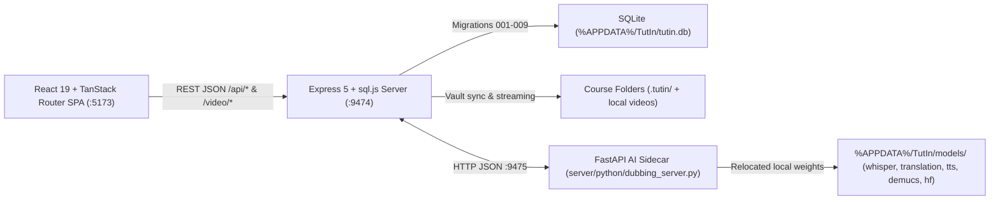

# TutIn v8.0 Beta Technical Architecture

## System Overview

## Backend (`server/`)

### Entry & Networking (`index.js`)
- Binds exclusively to `127.0.0.1` starting at `DEFAULT_PORT = 9474` (`findAvailablePort`), serving CORS-allowed localhost requests and range-requested video streams (`/video/*filePath`).
- In production (`client/dist/` present), serves the built SPA fallback directly on the backend port.

### Database & Migrations (`database.js`)
Uses `sql.js` persisted to `%APPDATA%/TutIn/tutin.db` (or `$TUTIN_DATA_DIR/tutin.db`):
- **001:** Core tables (`courses`, `modules`, `videos`, `notes`, `watch_sessions`, `analytics`, `instructors`, `roadmaps`, `settings`).
- **002–006:** Subtitle sources, `canvas_nodes`/`canvas_edges`/`canvas_viewports`, dubbed track columns, course language, and primary transcript tracking.
- **007 (Canvas v2):** Adds `canvas_groups` (video/custom artboards), `canvas_strokes` (freehand vector ink), `canvas_course_meta` (`dismissed_note_ids`, sync revision), and rich node/edge metadata (`origin_lesson_idx`, `origin_video_id`, `timestamp`, `membership_state`, `is_canvas_only`, `image_src`, `caption`, `accent_index`, `edge_kind`, `from_side`, `to_side`, `style`, `label`).
- **008 (Orphaned Canvas Node Cleanup):** Updates the `canvas_nodes.note_id` schema definition to `ON DELETE CASCADE` and purges any existing orphaned `video-note` rows (and dangling edges) left behind by prior Player note deletions.

### API Surface (`server/routes/`)
- **`/api/courses`, `/api/modules`, `/api/videos`:** Course CRUD (`POST /api/courses` keeps `last_accessed_click_time` null until engaged), explicit engagement logging (`POST /api/courses/:id/access` for `'player'` or `'external'` visits), progress calculation (`videos` or `duration` mode via `/api/courses/recalculate-progress`), qualified history/resume updates (`PUT /api/videos/:id/progress` updates playback progress and only sets `videos.last_watched_at` and `courses.last_accessed` when `recordHistory === true`), atomic note->canvas cascades when deleting modules/videos (`deleteLinkedCanvasNodesForNotes` + vault notes/canvas sync), folder scanning/resync (`services/courseScanner.js`), vault hydration ID collision remapping (`POST /api/courses/:id/hydrate-vault`), path relinking (`services/pathRepair.js`), custom thumbnail upload, and external URL metadata updates.
- **`/api/notes`:** Timestamped note CRUD (`formatNoteRow` returning both SQLite `snake_case` columns and normalized `camelCase` aliases + parsed `images`/`tags` arrays), transactional deletion cascade (`DELETE /:id` and `DELETE /by-video/:videoId` call `deleteLinkedCanvasNodesForNotes` and sync both `.tutin/notes/` and `.tutin/canvas.json`), and strict MIME-validated, path-confined screenshot storage with per-directory SHA-256 content-hash deduplication (`POST /api/notes/media`, `GET /api/notes/media/:courseId/:filename` serving with `{ dotfiles: 'allow' }` inside `<courseFolder>/.tutin/notes/screenshots/` or AppData fallback).
- **`/api/canvas`:** Reads/writes Canvas v2 snapshots (`GET/PUT /api/canvas/:courseId`, lightweight pan/zoom `PATCH /api/canvas/:courseId/viewport`) across SQLite (`canvas_groups`, `canvas_nodes`, `canvas_edges`, `canvas_strokes`, `canvas_viewports`, `canvas_course_meta`), uses course-scoped SQL predicates (`course_id` conflict guards, chunked `SQL_CHUNK_SIZE = 400` deletions, preloaded valid `note_id` sets, no-op stroke write skipping) and Video Artboard IDs (`vgroup-${courseId}-${lessonIdx}`), self-heals legacy `'canvas-only'` `membershipState` on video-linked cards, and syncs `<courseFolder>/.tutin/canvas.json`.
- **`/api/transcripts` & `/api/summaries`:** AI speech-to-text transcription (`POST /:videoId/transcribe` via Python `faster-whisper` + Silero VAD word timestamps with automatic browser WebGPU/WASM `whisper-worker.ts` fallback), 29-language subtitle translation (`POST /:videoId/translate` using offline `Xenova/nllb-200-distilled-600M` child process across 27 base languages + OpenRouter sliding-window isochrony translation for `ar-eg` Egyptian and `ar-sa` Saudi dialects), clause-level cue normalization (`normalizeCuesIntoClauses`, `1.5s–6.5s`, max ~84 chars), strict `.tutin/subtitles/` (automatically migrating any legacy `.tutin/captions/`) two-origin (`Uploaded` vs `AI`) multi-version track storage (`<videoBase>[|-u<N>|-generated].<lang>.vtt`, IDs `<lang>:uploaded`, `<lang>:uploaded:<n>`, `<lang>:generated` — legacy `Captions/`, `.source.vtt`, `-uploaded.`, `.tts.json` writers removed), per-language `Master` (`POST /:videoId/set-master`) & translation `Source` (`POST /:videoId/make-source`) flags, exact-track deletion (`DELETE /:videoId?id=<trackId>`), smart batch-apply across sibling lessons, and reading/serving existing `.tutin/summaries/*.md` files.
- **`/api/dub`:** Full AI voice dubbing generation, vault reconciliation, and playback streaming:
  - `GET /video/:videoId/languages`: Reconciles `videos.dubbed_tracks` against `.tutin/dubs/<relModulePath>/<videoBase>.<lang>.mp3` (with `extractDubLangFromFileName` exact suffix matching and automatic `migrateLegacyCourseAssets()` relocation of any legacy `Dubs/` MP3s) and returns `{ languages, tracks }` hydrated with `.meta.json` sidecar fields (`engine`, `bgMode`, `voiceGender`, `ttsModel`, `backgroundModel`, `pipeline`, `generationSeconds`, `sourceTranscriptFile`, `transcriptionModel`, `translationModel`, `generatedAt`). Similarly, `.tutin/subtitles/` stores portable `<subtitleBase>.meta.json` sidecars (`pipeline`, `generationSeconds`, `transcriptionModel`, `translationModel`, `sourceTrackFile`, `sourceLanguage`, `generatedAt`) hydrated by `reconcileVideoSubtitleSources` (`routes/transcripts.js`) and deleted cleanly with their tracks.
  - `POST /video/:videoId/generate`: SSE streaming dubbing pipeline (`engine: 'neural' | 'clone'`, `voiceGender: 'male' | 'female'`, `bgMode: 'none' | 'demucs'`). If target-language subtitles are absent, auto-transcribes (`transcribeWithPythonService`) and/or translates (`translateChunks` with `durationSec` isochrony) first, caches course-level instructor cloning profiles in `<courseFolder>/.tutin/dubs/_voice_profile/` (or `%APPDATA%/TutIn/dubs/_voice_profiles/<courseId>` for cloud courses), polls `dubbingService.js` -> FastAPI `:9475`, atomically writes `<videoBase>.<lang>.mp3` via `.tmp` rename alongside `<videoBase>.<lang>.meta.json` (plus `%APPDATA%/TutIn/dubs/` fallback only for cloud courses), and records `dub_jobs`.
  - `GET /audio/:videoId?lang=`, `DELETE /video/:videoId?lang=`, `GET /gpu-info` (hardware CUDA/MPS/CPU status + `getModelsDiskStats()`), `POST /set-device`, and `POST /unload-models`.
- **`/api/analytics` & `/api/roadmaps` & `/api/instructors`:** Watch-session logging, calendar history feed (`GET /api/analytics/history` scoping `_ext_mock` rows strictly to direct external-link courses rather than `youtube`/`google-drive` courses with URLs) & delete/clear endpoints (`DELETE /api/analytics/history*`), global roadmap CRUD, and persistent instructor avatar profiles.
- **`/api/settings` & `/api/data` & `/api/fs` & `/api/youtube` & `/api/search`:** Server-persisted app settings (`GET/PUT /api/settings`, `DELETE /api/settings/reset`), full SQLite + Canvas v2 JSON backup/restore (`/api/data/export`, `/api/data/import` with post-import vault notes/canvas sync, `/api/data/reset`, `/api/data/detect-durations`), native OS folder/image pickers & `Show in Explorer` (`POST /api/fs/open-folder`), YouTube playlist import & clause-normalized caption fetching (`GET /api/youtube/transcript`), and catalog search.

### Python AI Sidecar & Centralized Model Storage (`server/python/dubbing_server.py`, `utils/modelManager.js`, `services/dubbingService.js`)
- **Centralized Models Layout (`%APPDATA%/TutIn/models/`):** On server startup (`index.js`), `relocateAndCleanModelsDir()` migrates legacy weights without re-downloading (`models/ai` -> `models/translation`, `models/torch` & `~/.cache/torch/hub/checkpoints/*.th` -> `models/demucs`, `huggingface/hub/models--Systran--faster-whisper-*` -> `models/whisper`, root `tts_models--*` -> `models/tts`), purges obsolete `models/punctuation/`, keeps `TTS_HOME = modelsRoot` (since Coqui TTS natively appends `/tts`), and exposes disk telemetry via `getModelsDiskStats()`.
- **Self-Contained FastAPI AI Sidecar (`server/python/dubbing_server.py` on `127.0.0.1:9475`):** Spawned by `dubbingService.js` using `.venv` and `getPythonEnv()`:
  - **Voice Synthesis:** Concurrent Microsoft Edge Neural TTS (`edge-tts` `comm.stream()`, `asyncio.Semaphore(4)`, native speaking-rate tuning across all 29 languages including `ar-eg`/`ar-sa`, decoded via `get_ffmpeg_bin()` pipe + `AudioSegment.from_wav` so Windows environments without `ffprobe` work out of the box) OR local GPU/MPS/CPU Coqui `XTTS-v2` zero-shot cloning using cached course speaker latents (`instructor_latents.pt` + `instructor_ref.wav` sampled at `24kHz` with `highpass=f=80` and zero `8kHz` lowpass muffler, single-pass `temperature=0.60`, and a 5-minute idle VRAM reaper).
  - **Background Audio Modes & Elastic Alignment:** Supports **Off** (`bgMode: "none"`, pure dialogue `.mp3` with original video muted cleanly during playback) and **Music & SFX** (`bgMode: "demucs"`, `htdemucs --two-stems=vocals` stem separation mixed beneath dialogue with smooth FFmpeg sidechain compression and zero room-tone hum loop); absorbs up to `85%` (max `1.4s`) of downstream gaps + up to `0.40s` spillover, trims leading/trailing/internal dead air, caps `rubberband`/`atempo` tempo correction at `<= 1.28×`, applies median-relative loudness leveling clamped within `±3.5 dB`, and runs thread-locked `Faster-Whisper` transcription (`WHISPER_LOCK`).
  - **Client Request Safety & Player Dub Gating:** `apiRequest` (`client/src/lib/api.ts`) catches aborted/failed fetches cleanly (`aborted: true`, preventing React 19 StrictMode `AbortError` promise rejections on unmount), while `CoursePlayer` (`src/components/player/course-player.tsx`) scopes `dubState` to the verified `lessonId` so `<audio>` only requests `/api/dub/audio/:videoId?lang=` after `/languages` confirms the track exists.

### Deferred Future Modules
OpenRouter note/lecture summarization remains deferred to a future phase.

## Frontend (`client/`)

- **Routing, Code-Splitting & Responsive Shell:** File-based TanStack Router SPA (`src/routes/`) with `autoCodeSplitting` (`/` library, `/learn/$courseId` player with `?lesson`, `?videoId`, `?t`, `?tab` deep-links, `/canvas/$courseId`, `/roadmap`, `/instructors`, `/history`, `/analytics`, `/manage/$courseId`), `defaultPendingMs: 120` / `defaultPendingMinMs: 250`, and route-matched flat shimmer `pendingComponent` skeletons (`src/components/ui/skeleton.tsx`). `AppShell` (`src/components/layout/app-shell.tsx`) renders a responsive `flex-col md:flex-row` frame where `IconDock` sits at the bottom on mobile (`< 768px`, `h-14 border-t`, with `Home` included and the theme toggle hidden via `hidden md:flex`) and pins to the left on desktop (`>= 768px`, `w-16 h-dvh`), lazily importing root modals (`SettingsModal`, `WelcomeGuideModal`, `SyncPreviewModal`, `EditCourseModal`, `AddCourseModal`) on first open via `React.lazy` + `useHasOpened` latches. `CoursePlayer` dynamically imports `mpegts.js` only for `.ts` streams and lazily loads `ImageLightboxModal` on click (shared with `CourseCanvasPage`), while `HomePage` and `HistoryPage` progressively batch long feeds via `useProgressiveSlice` (`src/lib/use-progressive-slice.ts`, `IntersectionObserver` with scroll-restoration awareness) and `CourseCanvasPage` lazily mounts only viewport-adjacent cards on large boards (`> 36` visible cards, `700px` overscan, keeping selected/editing/connecting cards live).
- **Playback & Qualified Watch History:** HTML5 `<video>` paired with `mpegts.js` (`tsParser.js` + `videoStreamer.js`) for `.ts` MPEG-TS streams, YouTube `enablejsapi=1` `postMessage` playback state/time sync (`?start=` resume), Google Drive visibility-aware dwell tracking, and external-link bounce filtering (`src/lib/watch-history.ts`). Active engagement must cross `getHistoryThresholdSeconds(duration)` (up to `15s`, `3s`–`15s` scaled for short clips, `8s` off-tab sustain for external links) before committing Watch History or updating `last_accessed`, with `visibilitychange` + `pagehide` `keepalive` flushes.
- **State, Sync & Performance:**
  - `src/lib/courses.ts`, `course-lessons.ts`, `watch-history.ts`, `course-notes.ts`, `course-canvas.ts`: SQLite-backed stores and typed custom window event buses (`tutin:courses_changed`, `tutin:course_updated`, `tutin:course_deleted`, `tutin:notes_changed` with `NoteChangeSource` loop suppression and failure rollbacks + `keepalive` updates, `tutin:curriculum_changed`).
  - `CourseCanvasPage` memoizes `CanvasArtboard`, `CanvasCardView`, and `<CanvasDotGrid>` (`src/components/canvas/canvas-dot-grid.tsx` + pure helpers in `canvas-tokens.ts`, shared with `RoadmapPage` for $C^0$-continuous power-of-2 SVG dot-grid octaves visible down to `10%` zoom and zoom-compensated `computeCanvasEdgeScale`/`computeEdgeHitStrokeWidth` arrows with Obsidian-style hover halos in `CanvasEdgesLayer`) via `React.memo` + stable `useCallback` handlers, passes `selectable={false}` into read-mode `RichNoteHtmlContent` (suppressing native drag text/image selection and post-drag lightbox opens on non-editing cards), defers `setPointerCapture` until `>2px` resize drag movement so double-clicking a card's right/bottom edge or corner invokes Undo-able `measureFittedCardDimensions` (`canvas-card.tsx`) -> `resizeCardToFit` (`course-canvas.ts`) to fit content cleanly and repack `auto` Video Artboards, unifies 2D canvas organization through a single layout engine in `course-canvas.ts` (`layoutCardsInArtboard` with binary-search balanced vertical column partitioning `partitionCardsIntoBalancedColumns` / horizontal row grid / classic single column, 2D board packing via module rows / `~1.55:1` widescreen wrapped rows / Skyline bottom-left `findSkylineSlot` variable-width masonry, 2D overlap cascade resolution `resolveArtboardOverlaps`, wrap-aware `buildAutoChronoEdgesForGroup`, and HUD-safe `computeFitViewport` down to `10%` min zoom), unifies card/artboard dragging and `Alt+Drag` duplication through a single `dragSelectionRef` + shared pure `collectCanvasSelectionItems` / `cloneCanvasSelectionItems` / `pasteCanvasClipboardPayload` / `groupSelectionIntoArtboard` pipeline in `course-canvas.ts` (using custom MIME `application/x-tutin-canvas` with in-memory fallback, converting cloned `video-note` / `video-artboard` items into independent `canvas-note` / `custom-artboard` instances to preserve 1:1 Player sync invariants), and splits lightweight `saveCourseViewport` (`PATCH /viewport`) updates from structural `saveCourseCanvas` (`PUT`) writes.
  - `src/lib/app-settings.ts`: Implements a 3-tier persistence architecture across the client and SQLite (`/api/settings`):
    1. **Global Forever Preferences (`AppSettings` in `tutin_settings` localStorage + SQLite `/api/settings`):** Hydrates, debounces (`180ms`), and flushes on `pagehide` (`keepalive`) `theme`, `themePreset`, `autoPlay`, `resumePlayback`, `autoMarkCompleteAt`, `progressCalculationMode`, `autoDetectThumbnails`, `playbackSpeed`, `skipDuration`, `playerVolume`, `playerMuted`, `playerRemainingTime`, `playerSidebarOpen`, `notesSortOrder`, `notesSmartPauseEnabled`, `notesSmartPauseDelay`, `notesSmartPauseRewind`, `playerShortcutsEnabled`, `librarySort`, `analyticsRange`, `canvasBoardLayout`, `canvasCardLayout`, `canvasColorByModule`, `dubVoiceEngine`, `dubVoiceGender`, `dubBgMode`, `dubComputingDevice`, `dubUnloadIdleModel`, caption appearance, API keys/models, and `welcomeGuideSeen`.
    2. **Per-Course Forever Study Structure (`CourseUiPrefs` in `tutin_course_ui_prefs` localStorage + SQLite `/api/settings` `courseUiPrefs`):** Persists per-course `activeTab` (`playlist` | `notes` | `transcript`), `lastVideoId`, `openModules` (`Record<moduleId, boolean>` shared across `PlaylistTab` and `CurriculumManager`), `subtitleTrack` (including explicit `"off"`), `transcriptLang`, and `dubLang`, with timestamp-based server merge and automatic cleanup on `tutin:course_deleted`.
    3. **Per-Session Transient UI Memory (`sessionStorage` + Keep-Alive DOM Mounting):** Keeps `<aside>` and all 3 `CoursePlayer` tab panels (`PlaylistTab`, `NotesTab`, `TranscriptTab`) mounted via CSS `hidden` (`role="tabpanel"`) for 0ms tab switches while persisting scroll positions (`tutin_session_scroll` for `playlist:<courseId>`, `notes:<courseId>:<lessonKey>`, `transcript:<courseId>:<videoId>`, and `page:<pathname>` on `<main>`), unsaved note drafts (`tutin_session_note_drafts` per `courseId:lessonKey`), and active page filters (`tutin_session_filters` for Home, Instructors, and History).
  - `src/lib/transcript-ai.ts`, `src/components/shared/ai-job-trace.tsx` & `src/components/player/use-transcript-copy.ts`: Maintains the queued/running AI subtitle & voice dubbing job store (`TranscriptJobItem.steps: TranscriptJobStep[]` across `mode: "transcribe" | "translate" | "dub"`, exporting `dubVideoAudio`, `DUB_UPDATED_EVENT`, and `DubTrackMeta`), advancing completed/active pipeline stages (`queued`, `extracting`, `loading`, `downloading`, `fetching`, `transcribing`, `translating`, `starting-dub`, `separating`, `synthesizing`, `saving`) and rendering expandable inline progress/cancel traces across `TranscriptTab`, `CurriculumManager`, and the shell `DotLogo` popover without reopening `TranscriptTranslateModal`. During dubbed playback, `CoursePlayer` pairs `<audio ref={dubAudioRef}>` with continuous muting of the original `<video>` audio (`v.muted = true`) while preserving speed sync across both media elements. `useTranscriptCopy` (`use-transcript-copy.ts`) powers single-cue and bidirectional drag-range transcript copying (`formatTranscriptCueRange` always slices in chronological order, `resolveCueIndexAtPoint` uses hit-testing with an $O(\log n)$ vertical binary-search fallback, synchronous pointerdown listener attachment with deterministic teardown, edge auto-scroll, and playback auto-scroll suppression during drag).
  - Note screenshots upload through `/api/notes/media` (keeping a singleton `IndexedDB` connection + LRU-bounded object URL cache in `media-store.ts` for offline fallback), while same-course image copies (`Copy image` visual signature cache, same-course clipboard HTML extraction, and server SHA-256 deduplication) reuse existing vault `/api/notes/media/<courseId>/<filename>` files without duplicating screenshots on disk. Embedded note images are capped at `288×220px` (`--note-image-max-width: 288px`, `--note-image-max-height: 220px` so widening Canvas cards never inflates embedded screenshots) and align automatically with the surrounding text direction (`left` for LTR text, `right` for RTL text via `detectTextBlockDirection`, `inferImageAlignmentFromContext`, and `syncImageBlockAlignments` in `markdown/note-dom.ts`). Mixed text + image selections extract sanitized rich HTML + plain text via `extractRangeClipboardPayload` (`markdown/note-dom.ts`), write `ClipboardItem` multi-MIME payloads via `copyRichContentToClipboard` (`lib/clipboard.ts`) / `onCutRange` (`lib/spellcheck.ts`), and preserve `/api/`, `media://` ``, list marker attrs (`data-md-bullet`, `data-md-delim`), and `<ol start>` on paste and export (`note-export.ts`). Note Markdown parsing, Live Preview reconciliation, and block editing follow a layered `notes/markdown/*` pipeline re-exported via `note-markdown.ts`: shared specs/builders (`note-specs.ts`), consolidated DOM/scope/boundary/HR helpers (`note-dom.ts`: `getTopLevelBlock`, `getTopLevelBoundarySibling`, `unwrapParagraphsInListItems`, `getEditableScope`, `resolveFocusTarget`, `normalizeEmptyBreak`, `isStandaloneHrBlock`, `getLiOwnChildLimit`, `hasOwnInlineContent`), inline delimiters/boundaries (`note-inline.ts`), Live Preview activation/reconciliation (`note-live-preview.ts`), block keyboard handlers (`note-blocks.ts`), and image block isolation (`note-images.ts`). Stored note HTML passes through `sanitizeStoredNoteHtml` (`markdown/note-dom.ts`, which normalizes `li` paragraph wrappers into ` ` soft breaks via `unwrapParagraphsInListItems`, strips transient Live Preview syntax via `stripLiveSyntaxArtifacts`, and finalizes deferred standalone `---`/`***`/`___` divider lines via `convertStandaloneHrLines`), while live editor inputs/pastes/commands and `serializeContainerMediaHtml` (`media-store.ts`) invoke `stripChromiumInlineArtifacts` (`markdown/note-dom.ts`) to strip inline `style` attributes, ``, non-semantic `` wrappers, and redundant nested `
` blocks while preserving semantic `data-task-content`, `data-md-syntax`, `data-md-url`, `data-md-hr`, `data-md-hr-active`, `data-md-bullet`, and `data-md-delim` nodes.

