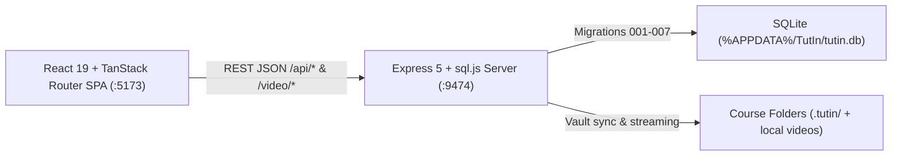

# TutIn v6 (`new ui`) Technical Architecture

## System Overview

## Backend (`new ui/server`)

### Entry & Networking (`index.js`)
- Binds exclusively to `127.0.0.1` starting at `DEFAULT_PORT = 9474` (`findAvailablePort`), serving CORS-allowed localhost requests and range-requested video streams (`/video/*filePath`).
- In production (`client/dist/` present), serves the built SPA fallback directly on the backend port.

### Database & Migrations (`database.js`)
Uses `sql.js` persisted to `%APPDATA%/TutIn/tutin.db` (or `$TUTIN_DATA_DIR/tutin.db`):
- **001:** Core tables (`courses`, `modules`, `videos`, `notes`, `watch_sessions`, `analytics`, `instructors`, `roadmaps`, `settings`).
- **002–006:** Subtitle sources, `canvas_nodes`/`canvas_edges`/`canvas_viewports`, dubbed track columns, course language, and primary transcript tracking.
- **007 (Canvas v2):** Adds `canvas_groups` (video/custom artboards), `canvas_strokes` (freehand vector ink), `canvas_course_meta` (`dismissed_note_ids`, sync revision), and rich node/edge metadata (`origin_lesson_idx`, `origin_video_id`, `timestamp`, `membership_state`, `is_canvas_only`, `image_src`, `caption`, `accent_index`, `edge_kind`, `from_side`, `to_side`, `style`, `label`).

### API Surface (`server/routes/`)
- **`/api/courses`, `/api/modules`, `/api/videos`:** Course CRUD (`POST /api/courses` keeps `last_accessed_click_time` null until engaged), explicit engagement logging (`POST /api/courses/:id/access` for `'player'` or `'external'` visits), progress calculation (`videos` or `duration` mode via `/api/courses/recalculate-progress`), qualified history/resume updates (`PUT /api/videos/:id/progress` updates playback progress and only sets `videos.last_watched_at` and `courses.last_accessed` when `recordHistory === true`), folder scanning/resync (`services/courseScanner.js`), path relinking (`services/pathRepair.js`), custom thumbnail upload, and external URL metadata updates.
- **`/api/notes`:** Timestamped note CRUD (`formatNoteRow` returning both SQLite `snake_case` columns and normalized `camelCase` aliases + parsed `images`/`tags` arrays), `.tutin/notes/` vault JSON export sync, and screenshot storage (`POST /api/notes/media`, `GET /api/notes/media/:courseId/:filename` serving with `{ dotfiles: 'allow' }`) writing files into `<courseFolder>/.tutin/notes/screenshots/` (or AppData `screenshots/` fallback for non-folder courses).
- **`/api/canvas`:** Reads/writes Canvas v2 snapshots (`GET/PUT /api/canvas/:courseId`, `POST /api/canvas/:courseId/sync-notes`) across SQLite (`canvas_groups`, `canvas_nodes`, `canvas_edges`, `canvas_strokes`, `canvas_viewports`, `canvas_course_meta`), uses course-scoped Video Artboard IDs (`vgroup-${courseId}-${lessonIdx}`, normalizing legacy unscoped `vgroup-<n>` payloads on write to prevent global `canvas_groups.id` primary-key collisions), self-heals legacy `'canvas-only'` `membershipState` on video-linked cards, and syncs `<courseFolder>/.tutin/canvas.json`.
- **`/api/transcripts` & `/api/summaries`:** Non-AI caption listing, `.srt`/`.vtt` upload, smart batch-apply across sibling lessons, and reading/serving existing `.tutin/summaries/*.md` files.
- **`/api/analytics` & `/api/roadmaps` & `/api/instructors`:** Watch-session logging, calendar history feed (`GET /api/analytics/history` scoping `_ext_mock` rows strictly to direct external-link courses rather than `youtube`/`google-drive` courses with URLs) & delete/clear endpoints (`DELETE /api/analytics/history*`), global roadmap CRUD, and persistent instructor avatar profiles.
- **`/api/settings` & `/api/data` & `/api/fs` & `/api/youtube` & `/api/search`:** Server-persisted app settings (`GET/PUT /api/settings`, `DELETE /api/settings/reset`), full SQLite + Canvas v2 JSON backup/restore (`/api/data/export`, `/api/data/import`, `/api/data/reset`, `/api/data/detect-durations`), native OS folder/image pickers & `Show in Explorer` (`POST /api/fs/open-folder`), YouTube playlist import, and catalog search.

### Intentionally Excluded Legacy Modules
Legacy AI pipelines (Whisper STT, NLLB translation, neural punctuation restoration, OpenRouter summarization, and Python/CUDA XTTS voice dubbing routes/services) were intentionally omitted during migration and will be designed cleanly in a separate phase.

## Frontend (`new ui/client`)

- **Routing:** File-based TanStack Router SPA (`src/routes/`) with `autoCodeSplitting` (`/` library, `/learn/$courseId` player with `?lesson`, `?videoId`, `?t`, `?tab` deep-links, `/canvas/$courseId`, `/roadmap`, `/instructors`, `/history`, `/analytics`, `/manage/$courseId`).
- **Playback & Qualified Watch History:** HTML5 `<video>` paired with `mpegts.js` (`tsParser.js` + `videoStreamer.js`) for `.ts` MPEG-TS streams, YouTube `enablejsapi=1` `postMessage` playback state/time sync (`?start=` resume), Google Drive visibility-aware dwell tracking, and external-link bounce filtering (`src/lib/watch-history.ts`). Active engagement must cross `getHistoryThresholdSeconds(duration)` (up to `15s`, `3s`–`15s` scaled for short clips, `8s` off-tab sustain for external links) before committing Watch History or updating `last_accessed`, with `visibilitychange` + `pagehide` `keepalive` flushes.
- **State & Sync:**
  - `src/lib/courses.ts`, `course-lessons.ts`, `watch-history.ts`, `course-notes.ts`, `course-canvas.ts`: SQLite-backed hooks and custom window event buses (`tutin:courses_changed`, `tutin:course_updated`, `tutin:course_deleted`, `tutin:notes_changed`, `tutin:curriculum_changed`).
  - `src/lib/app-settings.ts`: Hydrates and debounces `AppSettings` (`theme`, `resumePlayback`, `autoMarkCompleteAt`, `progressCalculationMode`, `autoDetectThumbnails`, `playerShortcutsEnabled`, `welcomeGuideSeen`) against `/api/settings`, keeping lightweight localStorage mirrors strictly for instant startup styling/keys.
  - Note screenshots upload through `/api/notes/media` (keeping IndexedDB helpers in `media-store.ts` strictly for local blob image compression helpers and offline cleanup).

